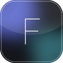
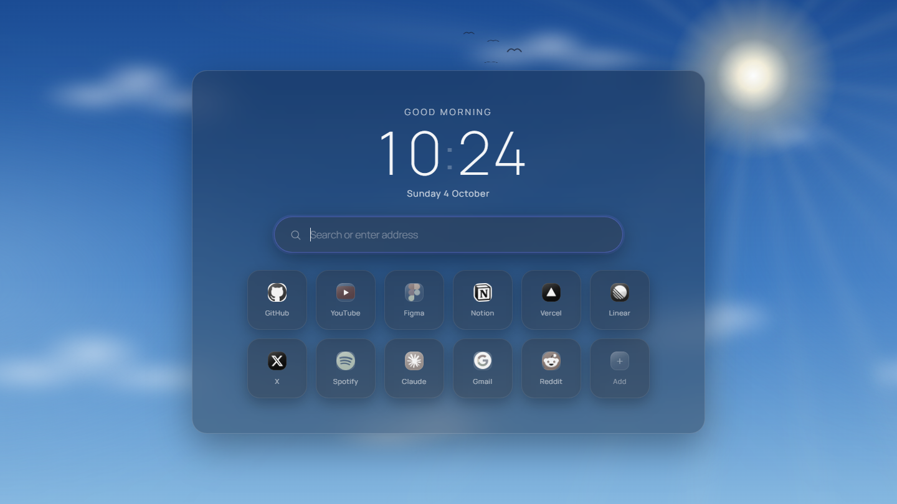
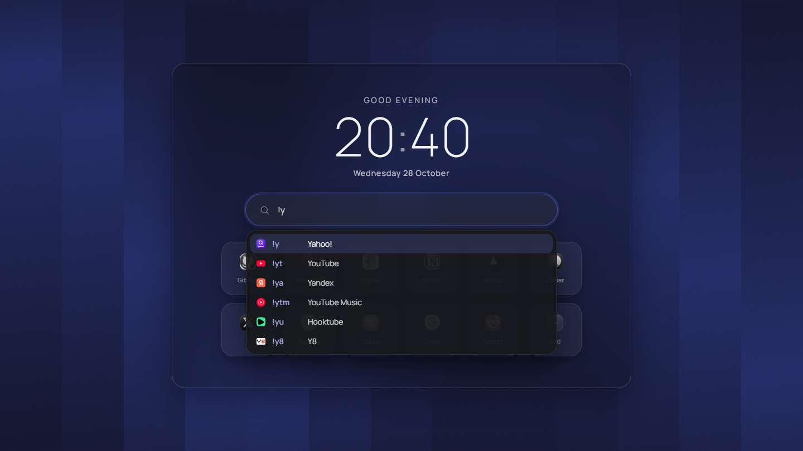
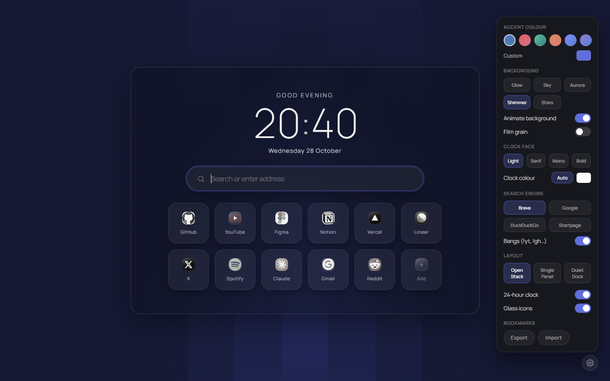

<div align="center">



# Frostpane

**A calm, glass-textured new tab page for Chrome, Brave, and other Chromium browsers.**

A live clock, quick search, and twelve bookmarks on a frosted-glass card, over a background that moves.

[](../../releases/latest)
[](LICENSE)
[](manifest.json)
[](#tech)

<br />



</div>

<br />

## Highlights

- **Five backgrounds** — a soft Glow, a living Sky, a drifting Aurora, Helium's Shimmer, or a starfield you arrive at through hyperspace
- **Four clock faces** in any colour you pick
- **Three layouts**, from a roomy grid to a minimal dock
- **Twelve bookmarks** with frosted-glass icons, reordered by dragging
- **Quick search** through Brave, Google, DuckDuckGo, or Startpage, with **bangs** like `!yt lofi`, and you can start typing anywhere
- **Nothing on screen until you ask** — settings appear on hover, and everything is saved in your browser

<br />

## Backgrounds

- **Shimmer** — Helium's animated wallpaper: bands of light in your accent colour that fan in as a tab opens
- **Sky** — follows the clock from dawn to a starlit night, with a sun glare on opening, drifting clouds, birds, and shooting stars; or pin it to one phase
- **Aurora** — slow colour fields built from your accent colour
- **Stars** — opens by dropping out of hyperspace, then drifts with your cursor
- **Glow** — the original: a dark page with two soft drifting lights

Any background can take a film-grain texture, and one switch freezes the motion without changing the look.

<br />

## Layouts

- **Open Stack** — centered clock over a 6×2 grid
- **Single Panel** — one dense card, bookmarks as pills
- **Quiet Dock** — a minimal icon strip, names on hover

<br />

## Search with bangs

Type `!` for suggestions from over 10,000 sites, then search one directly: `!yt lofi`, `!gh frostpane`, or `cats !w`. You can start typing anywhere on the page.

<div align="center">

</div>

<br />

## Settings

Hover the bottom-right corner for the settings panel. It stays open while you change things, so every option previews live.

<div align="center">

</div>

<br />

## Everything it does

<details>
<summary><b>Look and feel</b></summary>

- **Accent colour** — six presets or any colour from the built-in picker
- **Clock faces** — Light, Serif, Mono, or Bold with an accent gradient, plus an optional clock colour
- **Glass icons** — bookmark icons are desaturated and given a soft sheen so the grid reads as one pane of glass; full colour returns on the tile you hover, and a switch restores the original logos
- **Liquid-glass highlights** — a soft light follows the cursor across the card, search bar, and tiles
- **12 or 24-hour clock**, with the date and a greeting that matches the time of day
- **Respects reduce motion** — every animation stands down when your system asks for less movement

</details>

<details>
<summary><b>Search</b></summary>

- **Bangs** — `!yt lofi`, `!gh frostpane`, or `cats !w` search that site directly, from a catalog of over 10,000. Type `!` for suggestions
- **Type anywhere** — start typing anywhere on the page and it goes into the search bar
- A switch in settings turns bangs off

</details>

<details>
<summary><b>Bookmarks</b></summary>

- Click a tile to open it, right-click to edit, click an empty tile to add
- Drag one tile onto another to swap them, including into an empty slot
- Ctrl-click or middle-click opens a bookmark in a new tab
- Icons are fetched once and cached, so new tabs open instantly; the cache cleans itself up as bookmarks change

</details>

<details>
<summary><b>Backup</b></summary>

- **Export** saves your bookmarks and every setting to one JSON file
- **Import** restores it wherever Frostpane is installed; bookmark files from older versions still work

</details>

<br />

## Keyboard shortcuts

| Key | Action |
| --- | --- |
| `←` `→` `↑` `↓` | Move focus between bookmarks and the search bar |
| `Enter` / `Space` | Open the focused bookmark, or add one to an empty slot |
| `Ctrl`-click / `Cmd`-click | Open a bookmark in a new tab |
| Middle-click | Open a bookmark in a new tab |
| Any letter | Start a search from anywhere on the page |
| `!` then `↑` `↓`, `Tab` | Pick a bang from the suggestions |
| `Esc` | Close the settings panel, bookmark editor, or bang suggestions |

<br />

## Install

Frostpane isn't on the Chrome Web Store — install it as an unpacked extension:

1. Download the latest [release](../../releases/latest) and unzip it, **or** clone the repo:
   ```sh
   git clone https://github.com/talalahmad34/frostpane-home.git
   ```
2. Open `chrome://extensions` (or `brave://extensions`)
3. Enable **Developer mode** (top right)
4. Click **Load unpacked** and select the unzipped folder (or the cloned `frostpane-home` folder)
5. Open a new tab

<br />

## Tech

No build step, no framework — vanilla HTML, CSS, and JavaScript, backed by `chrome.storage.local` for persistence. Manifest V3. The only network requests are for site icons.

<br />

## Changelog

See [CHANGELOG.md](CHANGELOG.md) for release notes.

<br />

## License

[GPL-3.0](LICENSE) © [Talal Ahmad](https://github.com/talalahmad34). Releases up to v1.3.3 were MIT; from v1.4, which builds on GPL code, Frostpane is GPL-3.0.

### Credits

- **Shimmer background** — ported from [Helium Prism](https://github.com/imputnet/helium-prism)'s GradientShimmer, © imput, GPL-3.0 (`lib/gradient-shimmer.js`)
- **Starfield, type-to-search, and bang suggestions** — ported from [Shimmer Tab](https://github.com/dmitthedazed/shimmer-tab), © dmitthedazed, GPL-3.0 (`lib/starfield.js`, `lib/bangs.js`)
- **Bang resolver** — from [Helium New Tab](https://github.com/exsesx/helium-new-tab), © Oleh Vanin, MIT ([licence](licenses/helium-new-tab-MIT.txt))
- **Bang catalog** (`bangs.json`) — Helium's bang list, © Kagi Search and imput, MIT ([licence](licenses/bangs-MIT.txt))
